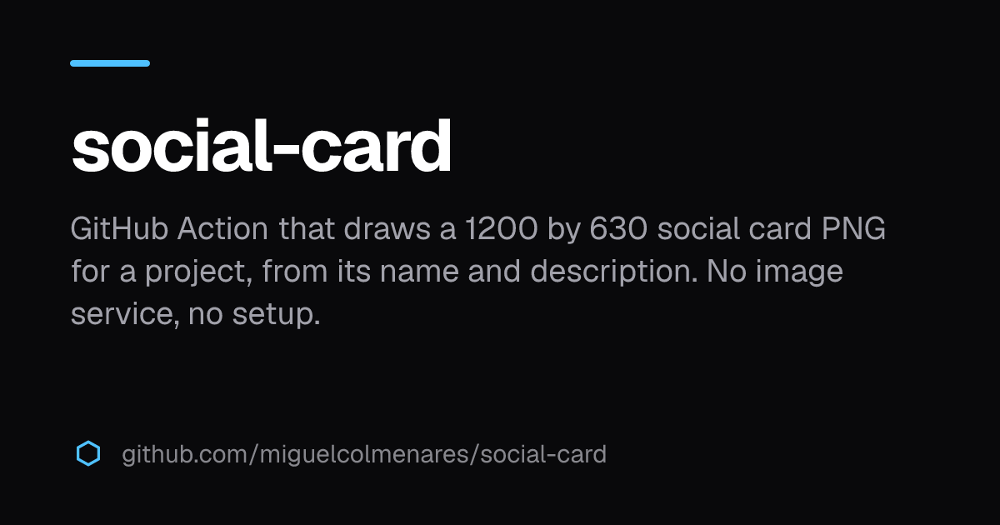

# social-card-action

A GitHub Action that draws the social card of a project: a 1200 by 630 PNG with the name, the description and the host, in the dark
style of [docs-sitekit](https://github.com/miguelcolmenares/docs-sitekit). It reads the repository, needs no image service and no
design tool, and writes the file where you say.



Use the picture for the link preview of a documentation site (`og:image`), or upload it as the social preview of the repository.

## Use

```yaml
- uses: actions/checkout@v7
- id: card
  uses: miguelcolmenares/social-card-action@v0.1.0
  with:
    path: public/social.png
```

With nothing else set, the name is the name of the repository, the description is its description, and the host at the foot is the
homepage of the repository, or `github.com/owner/repo` when it has none. Pin the action to a tag, or to the commit of the tag.

## Inputs

| Input                                            | Default                                                    | What it does                                                                                             |
| ------------------------------------------------ | ---------------------------------------------------------- | -------------------------------------------------------------------------------------------------------- |
| `path`                                           | `public/social.png`                                        | Where the PNG is written, relative to the repository. It stays inside the repository and ends in `.png`. |
| `name`                                           | the name of the repository                                 | The big text. Cut with an ellipsis after 60 characters.                                                  |
| `description`                                    | the description of the repository                          | The text under the name, cut at a word after about 150 characters, three lines at most.                  |
| `host`                                           | the homepage of the repository, or `github.com/owner/repo` | The text at the foot of the card.                                                                        |
| `background`, `title`, `text`, `muted`, `accent` | the dark colors of docs-sitekit                            | Hex colors such as `#4fc1ff`: the background, the name, the description, the host, and the bar and mark. |
| `node-version`                                   | `24`                                                       | The Node.js that runs the action. It needs 22.18 or newer.                                               |

## Outputs

| Output    | What it is                                                                                                 |
| --------- | ---------------------------------------------------------------------------------------------------------- |
| `path`    | The path of the card, relative to the repository.                                                          |
| `changed` | `true` when the file is new or different from the one that was there, `false` when the bytes are the same. |

The card is drawn the same way every time, so `changed` is `false` unless the text or the colors changed. A workflow that commits
only on change makes no empty commits.

## Keep the card up to date

The action writes the file and does not commit it, so you choose what happens to it. For the commit, use
[npm-auto-build](https://github.com/miguelcolmenares/npm-auto-build), the action that commits a build output only when it changed.
Draw the card first, then give the file to npm-auto-build as `paths`. When the card did not change, nothing is committed.

npm-auto-build installs your dependencies and runs a script of your `package.json` before it commits, `build` unless you set
`command`. So this needs a repository with a `package.json` and that script. The script runs after the card is drawn, and only the
`paths` are committed, so a build of a site can read the card, and a quick script such as `typecheck` works too.

The examples pin npm-auto-build by the full SHA of its `v3.0.0` tag, with the version in a comment, which is what its
documentation advises for a workflow with a write token, because a tag can move. A workflow with no write token can use `@v3`.

This workflow commits the card to the branch when you run it by hand, for example after you edit the description of the
repository. Mode `commit` pushes to the branch, so use it only on a branch that accepts pushes from the workflow.

```yaml
name: Social card

on:
  workflow_dispatch:

permissions:
  contents: read

concurrency:
  group: social-card-${{ github.ref }}
  cancel-in-progress: false

jobs:
  card:
    runs-on: ubuntu-latest
    permissions:
      contents: write # the push of the card
    steps:
      - uses: actions/checkout@v7
        with:
          persist-credentials: false # the build cannot read a token from .git/config
      - uses: miguelcolmenares/social-card-action@v0.1.0
        with:
          path: site/public/social.png
      # Pinned by full SHA because the job has a write token: the commit of the v3.0.0 tag.
      - uses: miguelcolmenares/npm-auto-build@7efbcdc1df67ec0ab3f81d03173e3507c32aa2fe # v3.0.0
        with:
          mode: commit
          paths: site/public/social.png
          commit-message: "Update the social card [skip ci]"
```

A repository that protects `main` does not accept the push. Use `mode: pr` instead: the action puts the card on its own branch,
`auto-build/main`, and keeps one pull request up to date. A person merges it.

```yaml
name: Social card

on:
  workflow_dispatch:

permissions:
  contents: read

concurrency:
  group: social-card-${{ github.ref }}
  cancel-in-progress: false

jobs:
  card:
    runs-on: ubuntu-latest
    permissions:
      contents: write # the push of the bot branch
      pull-requests: write # open and update the pull request
    steps:
      - uses: actions/checkout@v7
        with:
          persist-credentials: false
      - uses: miguelcolmenares/social-card-action@v0.1.0
        with:
          path: site/public/social.png
      - uses: miguelcolmenares/npm-auto-build@7efbcdc1df67ec0ab3f81d03173e3507c32aa2fe # v3.0.0
        with:
          mode: pr
          paths: site/public/social.png
          pr-title: "Update the social card"
          commit-message: "Update the social card"
```

With the default token, the setting "Allow GitHub Actions to create and approve pull requests" must be on, and a pull request made
with that token does not start your other workflows. If `main` requires checks, give `token` a personal access token or a GitHub
App token. The [npm-auto-build documentation](https://github.com/miguelcolmenares/npm-auto-build#mode-pr) has the details.

## With docs-sitekit

Draw the card into the `public/` folder of the site, and name it with `site.image` in `sitekit.config.json`:

```json
{ "site": { "image": "/social.png" } }
```

```yaml
- uses: miguelcolmenares/social-card-action@v0.1.0
  with:
    path: site/public/social.png
```

## The repository thumbnail

GitHub has no API to set the social preview of a repository. Draw the card to a path such as `.github/social-preview.png`, then
upload it once in **Settings → General → Social preview**.

## Limits

- The card uses the Latin letters of Geist. A character the font does not have is drawn as a box, so a name in another alphabet
  needs a picture of your own.
- A very long name or description is cut with an ellipsis, so the layout never leaves the picture.
- The action installs its own dependencies (`satori`, `@resvg/resvg-js` and Geist) in the job, about 40 MB, in a few seconds. They
  are never added to your repository or to your site.

## License

MIT. The third-party packages and fonts are listed in [THIRD_PARTY_NOTICES.md](THIRD_PARTY_NOTICES.md).
